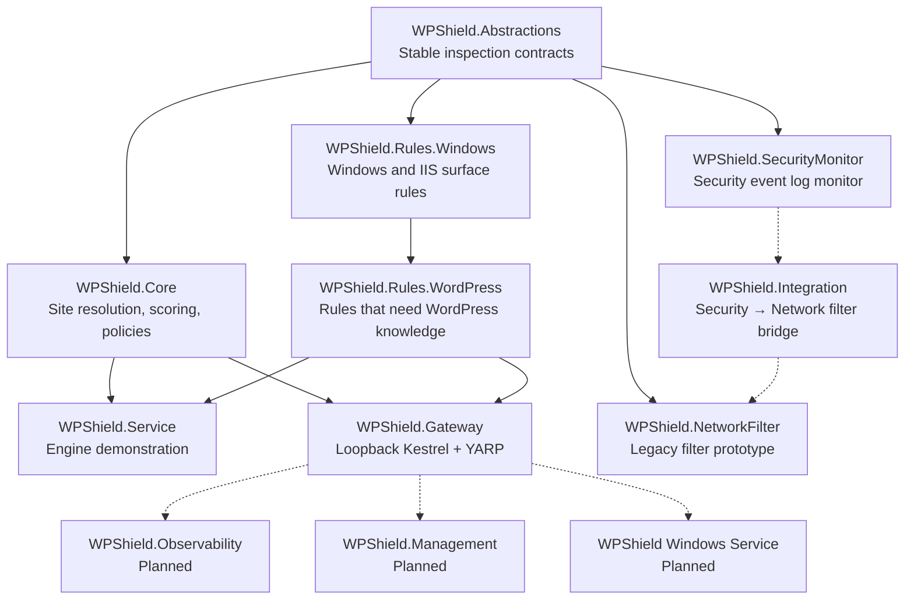
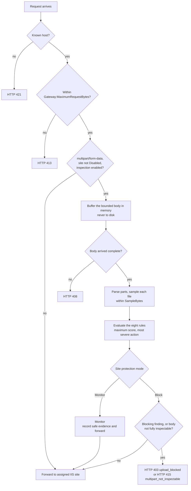

# Gateway reference

[Español](../es/referencia-gateway.md) · [Documentation index](../README.md)

## What a finding looks like

<picture>
  <source media="(prefers-color-scheme: dark)" srcset="https://raw.githubusercontent.com/peopleworks/WPShield/main/assets/hero-dark.svg">
  
</picture>

<sub>Neither finding blocks on its own. 50 + 30 reaching the threshold is the design, and the verdict is a rule ID, a score and the evidence behind it.</sub>

WPShield's claim is that a decision can be explained. Every finding carries a stable rule ID, a score, a message key and the minimal evidence behind it, so an operator can argue with it rather than trust it.

<details open>
<summary><b>A worked example</b> — one upload named <code>invoice.php.jpg</code>, and one named <code>web.config</code></summary>

Both arrive at a WordPress upload endpoint on a site running in `Monitor` mode with the default thresholds: observe at 30, block at 80.

```http
POST /wp-admin/async-upload.php HTTP/1.1
Host: wordpress-one.example
Content-Type: multipart/form-data; boundary=----WPShieldExample

------WPShieldExample
Content-Disposition: form-data; name="async-upload"; filename="invoice.php.jpg"
Content-Type: image/jpeg
```

**First the name is normalized.** Rules never see the raw client value:

| Submitted | Reaches disk as | Extension segments | Anomalies removed |
| --- | --- | --- | --- |
| `invoice.php.jpg` | `invoice.php.jpg` | `php`, `jpg` | none |
| `web.config` | `web.config` | `config` | none |

**Then the rules run and their scores are summed**, capped at 100:

```json
{
  "SiteId": "wordpress-one",
  "Score": 80,
  "RecommendedAction": "Observe",
  "Findings": [
    {
      "RuleId": "WP-UPLOAD-001",
      "Score": 50,
      "MessageKey": "Findings.ExecutableUploadExtension",
      "Evidence": {
        "extension": ".php",
        "position": "embedded",
        "normalizedName": "invoice.php.jpg"
      }
    },
    {
      "RuleId": "WP-UPLOAD-002",
      "Score": 30,
      "MessageKey": "Findings.DisguisedUploadExtension",
      "Evidence": {
        "executableExtension": ".php",
        "presentedExtension": ".jpg",
        "normalizedName": "invoice.php.jpg"
      }
    }
  ]
}
```

`web.config` needs one rule and no arithmetic:

```json
{
  "SiteId": "wordpress-one",
  "Score": 100,
  "RecommendedAction": "Observe",
  "Findings": [
    {
      "RuleId": "IIS-CONFIG-001",
      "Score": 100,
      "MessageKey": "Findings.IisConfigurationUpload",
      "Evidence": { "normalizedName": "web.config" }
    }
  ]
}
```

Four things worth noticing, because they are the whole point:

1. **`RecommendedAction` is `Observe`, not `Block`, and the score is not what decided that.** The site is in `Monitor` mode. The same two requests against a site configured with `"Mode": "Block"` return `Block`, at 80 and at 100 respectively. Monitor is the default; blocking is a per-site decision an operator makes deliberately.
2. **`.php` in a non-final position scores 50, not 90.** `invoice.php.jpg` is not executable everywhere — it is executable under a PHP-FastCGI installation with `cgi.fix_pathinfo` enabled, or an IIS handler mapping that matches on a wildcard. That single weak signal does not reach the threshold on its own; it takes the disguise finding on the same name to get there.
3. **`web.config` is the Windows-specific one.** IIS reads it from every directory it serves. Writing one into `wp-content/uploads` can register a handler mapping, re-enable script execution an operator disabled, or relax authorization for the directory — remote code execution without uploading a script at all. A rule set written for Linux hosting has no reason to look for it.
4. **A benign `readme.php.txt` scores exactly 80 as well**, and cannot be told apart from `invoice.php.jpg` by name alone. That is why the project's advice is to stay in `Monitor` and read your own upload traffic before switching any site to `Block`. `archive.tar.gz`, `style.min.css` and `holiday.jpg` score 0 and produce no findings at all.

**Run it yourself.** The shipped demonstration submits a third, deliberately evasive synthetic name — `..\..\photo.php.jpg.` — with a harmless PHP marker in the sample:

```powershell
dotnet run --project src/WPShield.Service
```

```json
{
  "SiteId": "wordpress-one",
  "Score": 100,
  "RecommendedAction": "Observe",
  "Findings": [
    { "RuleId": "WP-UPLOAD-001", "Score": 50, "MessageKey": "Findings.ExecutableUploadExtension",
      "Evidence": { "extension": ".php", "position": "embedded", "normalizedName": "photo.php.jpg" } },
    { "RuleId": "WP-UPLOAD-002", "Score": 30, "MessageKey": "Findings.DisguisedUploadExtension",
      "Evidence": { "executableExtension": ".php", "presentedExtension": ".jpg", "normalizedName": "photo.php.jpg" } },
    { "RuleId": "FILE-NAME-001", "Score": 60, "MessageKey": "Findings.UnsafeUploadFileName",
      "Evidence": { "anomalies": "pathSeparator,trailingDotsOrSpaces", "normalizedName": "photo.php.jpg" } },
    { "RuleId": "PHP-CONTENT-001", "Score": 75, "MessageKey": "Findings.PhpTagInUpload", "Evidence": null }
  ]
}
```

The directory prefix and the trailing dot are reported by `FILE-NAME-001` and then discarded. Evidence always carries the normalized name, never the raw one, so a name carrying control characters cannot reach a log consumer intact.

</details>

> [!NOTE]
> The JSON above is the inspection engine's own output — the last block is what the console demonstration prints. The same rules now run on gateway traffic too: a `multipart/form-data` request is buffered within the request limit, each file part is reduced to a bounded name and a bounded leading sample, every rule is evaluated, and the request is forwarded or refused according to the site's mode. Nothing else is inspected — urlencoded forms, JSON, XML-RPC and `application/octet-stream` PUTs stream through untouched. See [bounded multipart inspection](m2-multipart-inspection.md) and the [project status](operator-reference.md#project-status) table.

## Why WPShield?

WordPress installations on Windows Server need a protection layer that understands both WordPress upload behavior and IIS hosting. WPShield is being built to inspect requests before they reach IIS, PHP, or WordPress while preserving multi-site isolation, operator control, and useful evidence.

<picture>
  <source media="(prefers-color-scheme: dark)" srcset="https://raw.githubusercontent.com/peopleworks/WPShield/main/docs/assets/iis-gap-dark.svg">
  
</picture>

<sub>The gap is not that Linux-oriented rules are weak. It is that the surface they were written against is a different surface.</sub>

WPShield aims to:

- Protect one or many WordPress sites hosted on the same Windows Server.
- Route each hostname only to its explicitly configured IIS destination.
- Detect executable uploads, disguised PHP content, and file-type mismatches.
- Inspect bounded request data without storing suspicious uploads.
- Start safely in **Monitor** mode and require explicit per-site activation of **Block** mode.
- Produce explainable findings with stable rule IDs instead of opaque verdicts.
- Keep security rules, user-facing messages, and documentation extensible and multilingual.
- Complement Microsoft Defender and normal WordPress hardening practices.

WPShield is **not** an antivirus, EDR, stored-file malware scanner, replacement for Microsoft Defender, WordPress patching solution, or volumetric DDoS mitigation service.

## Architecture

WPShield separates reusable inspection contracts and rules from HTTP hosting concerns.



### How a request finds its site

The current gateway is intended only for local testing. Public traffic continues to use the existing IIS bindings on ports 80 and 443, which WPShield never touches.

<picture>
  <source media="(prefers-color-scheme: dark)" srcset="https://raw.githubusercontent.com/peopleworks/WPShield/main/docs/assets/host-resolution-dark.svg">
  
</picture>

<sub>No default entry and no wildcard. A host WPShield does not know has nowhere to go, and a host claimed twice is a startup failure rather than a silent last-one-wins.</sub>

### How a request is inspected

Every stage below runs today. The three conditions in the second decision are what keep ordinary page
traffic on the unbuffered path it has always taken: a request that is not `multipart/form-data`, or
that belongs to a `Disabled` site, or that arrives while `Gateway:Multipart:Enabled` is `false`, never
allocates a buffer at all.



## Security model

The following are project invariants:

- **Monitor by default.** Blocking requires explicit per-site configuration.
- **Fail closed for unknown hosts.** WPShield has no fallback destination.
- **Loopback-only during M1 and M2.** Gateway and management listeners are not public.
- **Untrusted forwarding headers are replaced.** Internet-provided `X-Forwarded-*` values are never trusted.
- **Bounded processing.** Request sizes, streams, samples, multipart sections, headers, and timeouts must have limits.
- **No suspicious upload persistence.** Upload inspection must not create temporary malware collections on disk.
- **Privacy-safe evidence.** Logs must exclude credentials, authorization values, cookies, nonces, tokens, complete query strings, request bodies, and upload content.
- **Explainable decisions.** Findings retain a stable rule ID, score, message key, minimal evidence, and recommended action.
- **No automatic production changes.** WPShield does not modify IIS, DNS, certificates, firewall rules, Windows services, or public ports automatically.
- **Host-wide blocking is unavailable.** The CLI refuses the legacy filter before accessing a packet driver.
- **Security monitor reads only.** `WPShield.SecurityMonitor` reads the Windows Security event log and never modifies, clears, or archives it. It requires Administrator privileges and refuses to start without them.
- **Security findings are observational.** The CLI sends findings to its output sink.

Read [THREAT_MODEL.md](../../THREAT_MODEL.md) for protected assets, trust boundaries, threats, and required safeguards. Report vulnerabilities according to [SECURITY.md](../../SECURITY.md), never through a public issue.

## Current rules

Rules match against a Windows-aware normalization of the file name rather than the raw client value, because `shell.php.`, `shell.php `, `shell.php::$DATA` and `..\..\shell.php` all reach disk as `shell.php`.

| Rule ID | Signal | Score |
| --- | --- | --- |
| `IIS-CONFIG-001` | Upload named `web.config`, which is remote code execution on IIS | 100 |
| `WP-UPLOAD-001` | PHP-executable extension in any position | 90 final, 50 embedded |
| `IIS-UPLOAD-001` | IIS-executable extension (`.aspx`, `.ashx`, `.asmx`, …) in any position | 90 final, 50 embedded |
| `PHP-CONTENT-002` | Valid image signature with PHP source proven to sit past the image's own data — the `GIF89a;` polyglot that defeats `getimagesize()` | 85 |
| `PHP-CONTENT-001` | `<?php` or `<?=` in a bounded upload sample | 75 |
| `FILE-TYPE-001` | Final extension claims one format and the leading bytes carry another | 70 script text, 70 `MZ`/ELF, 40 plain text |
| `FILE-NAME-001` | Path separator, alternate data stream, trailing dots or spaces, control character, reserved device name, excessive length | 60 |
| `WP-UPLOAD-002` | Executable extension disguised behind a benign one, such as `photo.php.jpg` | 30 |

Scores are summed within one file and capped at 100; the default thresholds are 30 to observe and 80 to block. Across several files in one request the gateway takes the maximum, never the sum, so twenty benign files cannot add up to a refusal. `IIS-CONFIG-001` and `IIS-UPLOAD-001` cover a Windows attack surface that protection layers written for Linux hosting do not address.

These rules now run on gateway traffic for `multipart/form-data` requests — see [bounded multipart inspection](m2-multipart-inspection.md) for what is parsed, what is sampled, and what each mode answers with. `FILE-TYPE-001` deliberately never fires on the declared `Content-Type`, because browsers derive it from the same extension and every non-browser client legitimately sends `application/octet-stream`. Each rule documents its own false positives in [upload rules](m2-upload-rules.md), and the request-path rules - `WP-PATH-001`, `WP-PATH-002`, `IIS-PATH-001` and the exposure family - are in [request path inspection](m2-5-request-path-inspection.md); future rules must include benign tests, false-positive analysis, safe evidence, and English and Spanish documentation.

## Traceability and inspection completeness

Each request that reaches the gateway's forwarding endpoint produces a final `request_completed`
log event with `SchemaVersion=1`. Its `RequestId` links the result to inspection findings and the
`X-WPShield-Request-ID` response header. The event records build versions, an opaque configuration
activation identifier, the resolved site and client, and the result of each inspection stage.

| Question | Evidence |
| --- | --- |
| What ran? | Gateway, engine and rule assembly versions, plus `ConfigurationRevision`, which identifies one startup activation and changes on restart |
| What was inspected? | Separate path and upload states: `not_started`, `not_inspected`, `partial` or `complete`, with reasons, scores and rule IDs |
| What did the rules recommend? | `PathAction` and `UploadAction`, after applying the site's mode and thresholds; Monitor can record `Observe` while permitting forwarding |
| What actually happened? | `Disposition`: `forwarded`, `rejected`, `forwarding_failed`, `cancelled` or `failed`, with a reason and whether forwarding was attempted |

For example, a suspicious upload in Monitor can have `UploadAction=Observe` and still end with
`Disposition=forwarding_failed` if the backend is unavailable. An inspection summary no longer
claims successful forwarding before the exchange finishes. The evidence tests cover mode
differences, malformed bodies, capacity and size limits, timeouts, cancellation, backend failures,
privacy and client-address consistency.

**Completeness is scoped.** A complete upload inspection covers configured leading samples and
filename views, not all file content. The activation identifier is not a retained configuration
snapshot. Missing log events mean unknown: filtering, queue saturation, storage failures or a process
crash can leave gaps. The local `WPShield.Evidence` meter reports observed queue and storage loss
independently of the log file. Its degraded flag stays set until the gateway restarts.

See the field reference and compatibility notes in [English](request-evidence.md) or
[Español](../es/evidencia-solicitudes.md).

### Preview a policy before changing it

`wpshield preview` reads a local copy of a gateway JSON Lines file containing `request_completed`
events. Use the exact `SiteId` recorded in the log for `--site`. This example estimates the effect
of switching that site to Block with an observation threshold of 30 and a block threshold of 80.

```powershell
wpshield preview --log-file .\synthetic-evidence.jsonl --site wordpress-one.example --mode Block --observe-threshold 30 --block-threshold 80
```

For example, if the file contains one eligible upload that scored 90 in Monitor, the JSON report
shows `eligibleRecords: 1` and `newlyRefused: 1`. That upload would have crossed the candidate block
threshold. The command writes the estimate to stdout and leaves the running policy in place.

Read `eligibleRecords` and `exclusions` alongside the estimate. When no record is comparable, the
impact fields are `null`. The default scan budgets are 10,000 lines, 16 MiB and 10 seconds. If a
budget interrupts the scan, `stopReason` identifies the limit. The guides explain eligibility,
privacy and exit codes. [English](policy-preview.md) · [Español](../es/vista-previa-politicas.md)

## Configuration

The gateway reads `Gateway` and `Sites` sections from `src/WPShield.Gateway/appsettings.json`. That file ships with placeholder hostnames only. Real deployment values belong in `appsettings.Local.json`, which is ignored by git and never copied into a published artifact, or in `WPSHIELD_` environment variables.

```json
{
  "Gateway": {
    "Urls": ["http://127.0.0.1:10000"],
    "AllowRemoteHealthChecks": false,
    "ActivityTimeoutSeconds": 100,
    "MaximumRequestBytes": 6291456,
    "Multipart": {
      "Enabled": true,
      "MaximumFileCount": 20,
      "MaximumFieldCount": 200,
      "MaximumPartHeaderBytes": 16384,
      "SampleBytes": 4096,
      "ReadTimeoutSeconds": 30
    }
  },
  "Sites": [
    {
      "Id": "wordpress-one",
      "Hosts": ["wordpress-one.example", "www.wordpress-one.example"],
      "Destination": "http://127.0.0.1:8081",
      "Mode": "Monitor",
      "ObserveThreshold": 30,
      "BlockThreshold": 80
    }
  ]
}
```

> [!IMPORTANT]
> Configuration is **not** hot-reloaded. Gateway and site options are validated once at startup and captured for the lifetime of the process; editing the file on a running gateway has no effect. Compare the startup log’s `ConfigurationRevision` with the final request event to identify the active policy. The gateway uses the same validated settings throughout that activation, including while an offline preview runs. The resolved site table at startup lists the active hosts. See [operator configuration](operator-configuration.md) for the local overlay, the JSON array-merge caveat, and what must never be committed.

| Setting | Purpose |
| --- | --- |
| `Gateway:Urls` | Listener URLs; M1/M2 require loopback IP addresses |
| `Gateway:AllowRemoteHealthChecks` | Keeps health endpoints local when `false` |
| `Gateway:ActivityTimeoutSeconds` | Forwarding activity timeout |
| `Gateway:MaximumRequestBytes` | Absolute per-request body limit; defaults to 6 MiB and cannot exceed 64 MiB. Also the ceiling on the multipart inspection buffer |
| `Gateway:Multipart:Enabled` | Whether multipart bodies are inspected at all. Setting it to `false` returns the gateway to pure streaming and no upload rule runs on live traffic; the gateway warns on every start while it is off |
| `Gateway:Multipart:MaximumFileCount` | File parts inspected per request; defaults to 20 and cannot exceed 100 |
| `Gateway:Multipart:MaximumFieldCount` | Non-file parts counted per request; defaults to 200 and cannot exceed 1000 |
| `Gateway:Multipart:MaximumPartHeaderBytes` | Header bytes allowed on one part; defaults to 16 KiB and cannot exceed 32 KiB |
| `Gateway:Multipart:SampleBytes` | Leading bytes kept per file for the content rules; defaults to 4096, cannot exceed 64 KiB, and **cannot go below 512**, under which `FILE-TYPE-001` and `PHP-CONTENT-002` can no longer decide |
| `Gateway:Multipart:MaximumConcurrentInspections` | Retained multipart buffers across all sites, including forwarding; default 10, ceiling 50. Monitor streams uninspected at capacity; Block returns 429 |
| `Gateway:Multipart:ReadTimeoutSeconds` | Deadline covering the whole inspection read; defaults to 30 and cannot exceed 120 |
| `Sites[].Id` | Stable site identifier used by routing and findings |
| `Sites[].Hosts` | Explicit hostnames assigned to this site |
| `Sites[].Destination` | Site-specific loopback IIS or synthetic backend |
| `Sites[].Mode` | `Monitor`, `Block`, or `Disabled`; use `Monitor` for evaluation |
| `ObserveThreshold` / `BlockThreshold` | Score thresholds used by action calculation |

M1.1 validates that sites exist, hosts are unique, listeners and destinations are safe, and destinations cannot point back to WPShield. Use only loopback destinations in the laboratory.

Every `Gateway:Multipart` value is validated the same way: an out-of-range setting **prevents startup** rather than being silently clamped, because an operator who asks for `"MaximumFileCount": 100000` and quietly gets 100 has been told nothing. The gateway prints the bounds it will actually enforce alongside its resolved site table on every start.

## What each response means

The gateway produces responses of its own in the following situations. Everything else comes from the backend site and is forwarded unchanged. `403`, `408` and `415` are new with bounded multipart inspection.

| Status | When | Body |
| --- | --- | --- |
| `421 Misdirected Request` | The `Host` header matches no configured site. There is no default backend, so this is the fail-closed path. | `{"error":"unknown_host","requestId":"…"}` |
| `403 Forbidden` | A site in `Block` mode received an upload whose findings reached its block threshold. Never produced in `Monitor`. | `{"error":"upload_blocked","requestId":"…","ruleIds":["…"]}` |
| `415 Unsupported Media Type` | A site in `Block` mode received a `multipart/form-data` body WPShield could not fully inspect — a boundary it refuses to parse, a body that is not valid multipart, or a file, field, header or name limit that stopped the read. `Monitor` forwards it intact and logs a warning instead. | `{"error":"multipart_not_inspectable","requestId":"…","reason":"malformed"|"limit_exceeded","ruleIds":["GATEWAY-MULTIPART-001"]}` |
| `429 Too Many Requests` | In Block mode, multipart buffer capacity is exhausted or a configured request-rate budget is exceeded. Monitor forwards and records the event. Only rate-budget refusals include `Retry-After`. | Error `multipart_concurrent_limit_exceeded` or `rate_limited`, plus `requestId` |
| `408 Request Timeout` | The body did not fully arrive within `Gateway:Multipart:ReadTimeoutSeconds`. Applies in every mode, `Monitor` included: a half-arrived body is not a finding, and forwarding it would hand WordPress a body shorter than its declared `Content-Length`. | `{"error":"request_timeout","requestId":"…"}` |
| `413 Content Too Large` | The declared `Content-Length` exceeds `Gateway:MaximumRequestBytes`, or a body of unknown length crossed that limit while streaming. | `{"error":"request_too_large","requestId":"…"}` |
| `502 Bad Gateway` | The assigned backend could not be reached, or went quiet for longer than the forwarding activity timeout. Nothing about the backend's failure is echoed to the caller. | `{"error":"backend_unavailable","requestId":"…"}` |
| `404 Not Found` on `/_wpshield/health/*` | A health probe arrived from a non-local caller while `AllowRemoteHealthChecks` is `false`, or the path is not a health endpoint that exists. | — |

A refusal body carries the request identifier and the triggering rule identifiers, and never the raw or normalized file name, the field name, the sample, the evidence, the site identifier, the destination, the score or the thresholds. The identifiers are disclosed because the complete rule catalogue is already published above; the score is withheld because a number turns evasion into hill-climbing, where a binary allow/deny forces a blind search. Content-policy refusals send no `Retry-After`; rate-budget refusals do include it.

Both health endpoints answer `200` locally: `/_wpshield/health/live` returns `{"status":"live","service":"WPShield.Gateway"}` and `/_wpshield/health/ready` returns `{"status":"ready","sites":2}`. Every response, forwarded or generated, carries an `X-WPShield-Request-ID` correlation header and `X-Content-Type-Options: nosniff`, and every response WPShield generates itself adds `Cache-Control: no-store`. That request ID is generated by WPShield; an inbound one is discarded rather than trusted.

## Troubleshooting

The gateway fails closed at startup rather than running on a configuration it cannot vouch for. Each refusal below is a real message from `GatewayConfigurationValidator`.

| Startup message | What it means |
| --- | --- |
| `M1 laboratory gateway may listen only on a loopback HTTP or HTTPS IP.` | `Gateway:Urls` contains something other than a loopback IP address. Hostnames are rejected too, because a name can resolve anywhere. |
| `Site '<id>' destination must remain on loopback during M1.` | A site points at a non-loopback backend. M1 and M2 are laboratory-only by design. |
| `Site '<id>' destination must not point back to a WPShield listener.` | The destination port matches a listener port, which would be a proxy loop. |
| `Host '<host>' is assigned more than once.` | Two sites claim the same hostname. Routing would be ambiguous, so it is refused rather than resolved by declaration order. |
| `Configuration mixes real hostnames with the documentation placeholders shipped in appsettings.json…` | JSON configuration merges arrays element by element, including the nested `Hosts` array, so a partial `appsettings.Local.json` leaves surplus example hosts active and routable. Declare every site and every host explicitly. See [operator configuration](operator-configuration.md). |
| `Gateway:MaximumRequestBytes must be between 1 and 67108864 bytes.` | The per-request limit is zero, negative, or above the 64 MiB ceiling. |
| `At least one site must be configured.` | The `Sites` array is empty. WPShield has no fallback destination by design. |
| `Failed to bind to address http://127.0.0.1:10000: address already in use.` | A gateway is already running. Stop it before starting another; nothing is silently shared. |

Two behaviours that look like defects and are not:

- **Editing `appsettings.json` while the gateway runs changes nothing.** Configuration is read and validated once. Restart the process, then read the resolved site table it prints.
- **A configured host returns `502`.** The site resolved correctly; there is simply no backend listening at its destination. Start the synthetic backend or the IIS site first.
