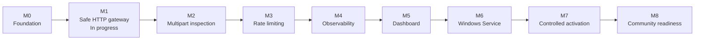

# Operator reference

[Español](../es/referencia-operador.md) · [Documentation index](../README.md)

## Choose an operator task

| Question | First command | Requirements and evidence |
| --- | --- | --- |
| Which rule fired on my IIS-hosted WordPress site? | `wpshield watch --plain` | Start the gateway in Monitor on loopback and read its evidence log. [Request evidence](request-evidence.md) |
| Which local ports are in use? | `wpshield network-monitor --listeners` | Use `--protocol tcp --local-address 127.0.0.1` to find sockets bound to IPv4 loopback. Add `--port-hints` for conventional port names or `--owners` for the observed PID. [Listener inventory](network-sensor-design.md#local-listener-inventory) |
| Can I see local ports in a window? | `dotnet run --project src/WPShield.Desktop -c Release` | Browse TCP listeners and bound UDP sockets in a Windows desktop window, with the process name when its start time confirms the observed PID. Search by address, port, PID, process or port name. [Desktop monitor](network-sensor-design.md#desktop-monitor) |
| Who is trying to log in to this server? | Open **Attacks** in the desktop monitor | Failed Remote Desktop, SMB and network logons from the last 24 hours, then live: totals, a timeline, one row per source address and a slide-in detail with the accounts tried and other attackers in the same network. **7 d** and **30 d** read the WPShield service's evidence store. Needs administrator rights, and says so instead of showing an empty board. [Attacks view](network-sensor-design.md#attacks) |
| Who attacked this server last week? | `wpshield attacks --range 7d` | Totals and top source addresses from the evidence store, or one address's history with `--source`. Says when an answer comes from hourly aggregates and lists unrecorded time as "no data", never zero. Elevated prompt; `--json` for scripts. [Attack history](network-sensor-design.md#attack-history-from-the-command-line) |
| What would WPShield block, and why? | `wpshield decisions --active` | The decision engine's records in Monitor: nothing is blocked. `would-block`, `protected`, `refused`, `report` and `expire`, with the rule, the counts and the expiry; without `--active`, a range of them with its coverage. Thresholds and the allow-list are `defense.*` settings. Elevated prompt; `--json` for scripts. [Decisions](network-sensor-design.md#decisions-monitor) |
| How do I name my office's address? | Open **Settings** in the desktop monitor, or `wpshield settings set labels.addresses --value-file labels.json --reason "..."` | Labels appear next to matching addresses in `wpshield attacks` and the Attacks view; they never allow or block. The window edits every setting without a JSON file; **My current connection** adds the address your Remote Desktop client reports. Changing a setting needs elevation and a reason, is recorded with who and why, and says when it takes effect. [Settings window](network-sensor-design.md#settings-window) · [Settings](network-sensor-design.md#settings) |
| Who is trying to log in to this server? | Open **Attacks** in the desktop monitor | Failed Remote Desktop, SMB and network logons from the last 24 hours, then live: totals, a timeline, one row per source address and a slide-in detail with the accounts tried and other attackers in the same network. Needs administrator rights to read the Security log, and says so instead of showing an empty board. [Attacks view](network-sensor-design.md#attacks) |
| Can I ask an assistant who attacked this server? | `wpshield mcp`, started by Claude Desktop or Claude Code | A read-only MCP server over the evidence store: totals, top sources, one address's history, a timeline, coverage and block decisions. Opens no port and changes nothing. The assistant must run elevated on the server, and its answers go to its model provider; account names only if you allow them. [MCP server](mcp-server.md) |
| How busy is one network adapter? | Open **Adapter traffic** in the desktop monitor | Compare received and sent bytes per second for one Windows interface. Works without Npcap. [Adapter traffic](network-sensor-design.md#adapter-traffic) |
| How much traffic involves selected TCP or UDP ports? | Open **Port traffic** in the desktop monitor | Type ports or add them from the port list, then select a capture adapter. The chart shows observed IP bytes per second and coverage for each interval. Requires Npcap and administrator privileges. [Traffic history](network-sensor-design.md#traffic-history) |
| How do I copy one record from a saved audit? | Open **Audit references** in the desktop monitor | Open one WPShield JSON snapshot, select the row with the arrow keys and press Ctrl+C to copy its reference. [Selected audit reference](network-sensor-design.md#selected-audit-reference) |
| What traffic is arriving and leaving? | `wpshield network-monitor --flows --interfaces Ethernet --all-ports` | Find the device ID with `wpshield network-monitor --list-interfaces`, then run the flow monitor with Npcap and administrator privileges. [Flow coverage](network-sensor-design.md#host-flow-view) |
| Which record confirms a login? | `wpshield network-monitor --sql-instance MSSQLSERVER --json` | Read the local Application log for SQL. For RDP, add `--rdp-port` and its local port number to a flow capture that includes that port. [Login evidence](network-sensor-design.md#remote-desktop-logon-evidence) · [Export one audit reference](network-sensor-design.md#selected-audit-reference) |

An instance-level SQL login can be verified even when its TCP flow attribution remains `unknown`. [Guía del operador en español](../es/diseno-sensor-red.md)

## Project status

| Capability | Status | Notes |
| --- | --- | --- |
| .NET 10 foundation and CI | Available | Nullable reference types, warnings as errors, central package management, CodeQL, formatting gate, Linux verification of the portable core |
| Multi-site host resolution | Available | Unknown hosts fail closed; no default backend |
| Explainable inspection engine | Available | Stable rule IDs, scoring, Monitor/Block action calculation |
| WordPress and IIS upload rules | Available | Windows-aware file name normalization, PHP and IIS executable extensions, `web.config` detection, disguised extensions, structural anomalies, file-signature mismatch, image/PHP polyglots |
| Loopback HTTP gateway | Prototype | Kestrel and YARP on `127.0.0.1:10000` |
| Gateway hardening | Available | Strict startup validation, safe 502 failures, and real synthetic multi-site integration coverage |
| Bounded request controls | Available | 6 MiB default, 64 MiB ceiling, early and streamed HTTP 413 enforcement |
| **Bounded multipart inspection** | **Available** | **The rules now run on gateway traffic.** `multipart/form-data` bodies are buffered in memory within the request limit — never to disk — inspected, then forwarded or refused. Bounded file, field, part-header, boundary, file-name and read-timeout limits, each with a ceiling configuration cannot raise. A concurrent-inspection limit caps how many bodies may be buffered at once; Monitor forwards and warns when the limit is reached, Block refuses with HTTP 429. |
| Inspection of non-multipart bodies | Planned | Nothing else is inspected: urlencoded forms, JSON, XML-RPC, `application/octet-stream` PUTs and other `multipart/*` subtypes stream through untouched |
| Inspection of archive contents | Planned | A `.zip` plugin or theme carrying a webshell is not detected, and plugin installation is a genuine upload path. No milestone assigned |
| Bound on concurrent buffered uploads | Available | `Gateway:Multipart:MaximumConcurrentInspections` defaults to 10, ceiling 50. Monitor forwards and warns at the limit; Block refuses with HTTP 429. |
| Host traffic monitor | Research preview | `wpshield network-monitor --flows` shows TCP/UDP endpoints, byte counts and initiators on one adapter. Each snapshot identifies the capture state and port scope. Login audits include the UTC query window and the reason for an unavailable source. Add `--history` for measured IP bytes per second and capture gaps. Use `--rdp-port` for Remote Desktop logon evidence or `--sql-instance` for SQL Server login outcomes by instance. The SQL snapshot also runs without packet capture. [Usage and coverage](network-sensor-design.md#host-flow-view) · [Guía en español](../es/diseno-sensor-red.md#vista-de-flujos-del-servidor) |
| Host-wide packet blocking | Unavailable | The CLI refuses `network-filter`. The replacement is tracked in [PR #86](https://github.com/peopleworks/WPShield/pull/86). |
| Security event monitoring | Available | `wpshield security-monitor` reports RDP brute-force and repeated failed-logon findings from the Windows Security log. |
| Security findings to packet enforcement | Planned | The integration library has an in-memory block-list sink. The CLI reports findings without applying network blocks. |
| Rate limiting and observability | Partial | Configured per-client/site/rule fixed-window budgets, structured file logs and redaction tests exist; broader M3/M4 work remains |
| Request evidence traceability | Available | Versioned final events correlate findings, build versions, configuration activation, inspection completeness and actual forwarding outcomes. |
| Evidence loss and community exports | Available | Local diagnostics count full-queue drops, failed file batches and skipped inspection stages. The operator PDF flags known gaps. `wpshield preview --format community` exports aggregates for one site under a synthetic label. |
| Offline IIS login evidence | Research preview | `wpshield iis-login` reads a copied W3C log for one site and reports line references for authenticated requests, challenge-compatible responses and Windows logon rejections. [Coverage and limits](iis-login-evidence.md) |
| Offline policy preview | Available | `wpshield preview` compares recorded scores with candidate Monitor/Block thresholds for one site. Bounded input, explicit exclusions and aggregate JSON; no configuration changes or content-rule replay. |
| Listener desktop view | Research preview | Local, read-only Windows inventory in English and Spanish. The web management dashboard remains planned for M5. |
| Production activation | Not approved | Requires M1-M6 validation and controlled M7 rollout |

See the detailed [roadmap](../../ROADMAP.md) and [threat model](../../THREAT_MODEL.md) before evaluating or contributing to the project.

## Getting started

### Prerequisites

- [.NET 10 SDK](https://dotnet.microsoft.com/download)
- Git
- PowerShell
- Windows Server and IIS only when performing the documented local IIS laboratory

Clone and validate the repository:

```powershell
git clone https://github.com/peopleworks/WPShield.git
cd WPShield
dotnet restore WPShield.slnx
dotnet build WPShield.slnx --configuration Release --no-restore
dotnet test WPShield.slnx --configuration Release --no-build
```

The suite is 2,144 tests across twelve projects — 251 for the abstractions, 90 for the core, 98 for the Windows rules, 293 for the WordPress rules, 544 for the CLI, 110 for the desktop monitor, 475 for the gateway, 41 for the network sensor, 14 for the network filter, 95 for the security monitor, 128 for the evidence store and 5 for integration. Runtime depends on the machine; the gateway suite includes timeout and cancellation scenarios.

### Build the release to carry to the server

On a build machine with the SDK — never on the server:

```powershell
.\publish.cmd
```

It produces a self-contained `win-x64` build of both executables — the gateway service and `wpshield.exe` — in one directory under `artifacts\`, with a `.zip` and its `.sha256`. The script is a thin wrapper over `wpshield publish`, which owns the packaging rules: it refuses to ship `appsettings.Local.json`, checks the binary version, and asserts the two executables share one runtime rather than doubling it. Copy the artifact across, verify the SHA-256, then run `wpshield preflight` on the server.

### Run the inspection engine demonstration

```powershell
dotnet run --project src/WPShield.Service
```

The output is the JSON shown in [what a finding looks like](gateway-reference.md#what-a-finding-looks-like). The service loads its default configuration from the compiled application directory. To provide a specific configuration file:

```powershell
dotnet run --project src/WPShield.Service -- src/WPShield.Service/appsettings.json
```

### Run the M1 gateway laboratory

> [!WARNING]
> Run this only on loopback with synthetic or explicitly prepared local backends. Do not expose port 10000 publicly and do not replace IIS ports 80 or 443.

```powershell
dotnet run --project src/WPShield.Gateway
```

The gateway prints its resolved site table before it accepts a request. Read it — it is the only place the effective routing is visible, because configuration is not hot-reloaded:

```text
info: WPShield.Gateway.Configuration[0]
      Gateway configuration resolved 2 site(s).
info: WPShield.Gateway.Configuration[0]
      Configured site. SiteId=wordpress-one Hosts=wordpress-one.example, www.wordpress-one.example Destination=http://127.0.0.1:8081/ Mode=Monitor
info: WPShield.Gateway.Configuration[0]
      Configured site. SiteId=wordpress-two Hosts=wordpress-two.example, www.wordpress-two.example Destination=http://127.0.0.1:8082/ Mode=Monitor
```

Check local health endpoints:

```powershell
curl.exe http://127.0.0.1:10000/_wpshield/health/live
curl.exe http://127.0.0.1:10000/_wpshield/health/ready
```

Test explicit host routing:

```powershell
curl.exe -I -H "Host: wordpress-one.example" http://127.0.0.1:10000/
curl.exe -i -H "Host: unknown.example" http://127.0.0.1:10000/
```

The unknown host must receive HTTP 421. A configured host also needs a matching local backend running at its configured destination; without one it returns HTTP 502, which is the correct answer rather than a fault.

Read the laboratory guide before using IIS:

- [English: M1 laboratory gateway](m1-lab-gateway.md)
- [Español: Gateway M1 de laboratorio](../es/m1-gateway-laboratorio.md)

## Before you evaluate this on a server you care about

This is a research preview, so the checklist is the point rather than a formality:

- [ ] The gateway listens on loopback only, and the public IIS bindings on ports 80 and 443 are untouched.
- [ ] Real hostnames, ports and destinations exist only in `appsettings.Local.json`, which git ignores and publish never copies. Nothing real is committed.
- [ ] Every site is in `Monitor`, and stays there until a week of that site's own upload traffic has been reviewed in the logs. `Block` now genuinely refuses requests, so the false positives named in [bounded multipart inspection](m2-multipart-inspection.md) stop being log lines and start being refusals.
- [ ] The resolved site table printed at startup was read line by line and matches what you intended to route.
- [ ] For this isolated evaluation, stopping the process leaves live traffic unaffected because IIS is unchanged. If IIS forwards to WPShield, disable the WPShield rewrite rule to bypass it before stopping the process.
- [ ] Any captured gateway log was checked for credentials, cookies, nonces and full query strings before it was kept or shared.
- [ ] `dotnet test WPShield.slnx --configuration Release` passes on the exact commit being evaluated.
- [ ] You have read [THREAT_MODEL.md](../../THREAT_MODEL.md) and accept what is **not** covered.

## Repository layout

```text
WPShield/
|-- src/
|   |-- WPShield.Abstractions/       Stable inspection contracts
|   |-- WPShield.Core/               Site resolution and rule evaluation
|   |-- WPShield.Rules.Windows/      Windows and IIS surface rules (portable)
|   |-- WPShield.Rules.WordPress/    Rules that need WordPress knowledge
|   |-- WPShield.Service/            Inspection engine demonstration
|   |-- WPShield.Logging/            JSON Lines file logging, kept out of the gateway
|   `-- WPShield.Gateway/            Loopback-only M1 HTTP gateway
|   `-- WPShield.NetworkSensor/     Passive network metadata capture (Npcap, operator-named ports)
|-- tests/                            xUnit test projects
|-- scripts/                          Read-only operator scripts: triage, IIS validation
|-- assets/                           Hero and social images
|-- docs/
|   |-- assets/                      Light and dark figure pairs
|   |-- en/                          English documentation
|   |   `-- adr/                     Architecture decision records
|   `-- es/                          Documentación en español
|       `-- adr/                     Registros de decisiones de arquitectura
|-- site/                             GitHub Pages landing page
|-- .github/                          CI, templates, and contributor guidance
|-- ROADMAP.md                        Detailed milestone plan
`-- THREAT_MODEL.md                   Security assumptions and safeguards
```

## Roadmap



| Milestone | Goal | Status |
| --- | --- | --- |
| M0 | Foundation, rule contracts, CI, and repository guidance | Complete except the configuration schema and localized validation messages |
| M1 | Hardened loopback multi-site HTTP gateway and synthetic tests | In progress |
| M2 | Bounded request controls, multipart inspection, and high-confidence rules | In progress |
| M3 | Configured per-client/site/rule budgets and retained-buffer limits | Partial; broader policies and exceptions remain |
| M4 | Privacy-safe structured events, metrics, rotation, and retention | Planned |
| M5 | Loopback multilingual management dashboard | Planned |
| M6 | Least-privilege Windows Service packaging and signed releases | Planned |
| M7 | Gradual Monitor-first production activation | Planned |
| M8 | Community rule packages and project release readiness | Planned |

The full acceptance criteria and task lists live in [ROADMAP.md](../../ROADMAP.md).
