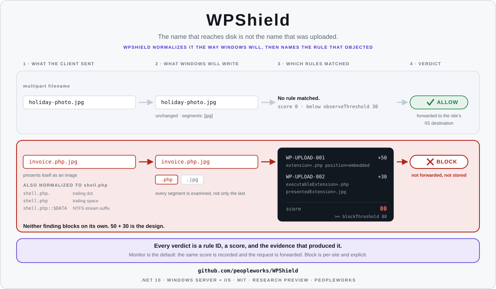
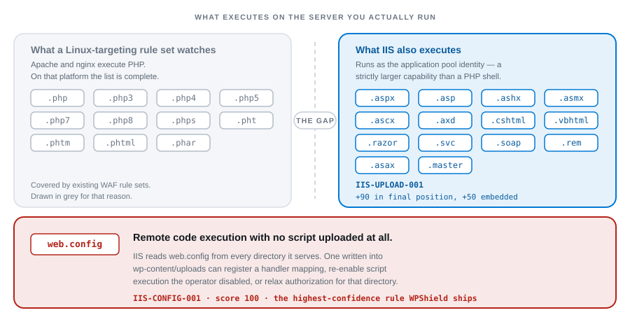
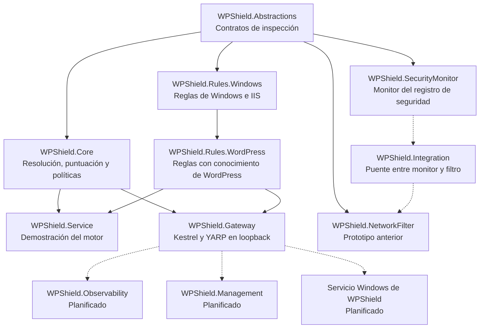
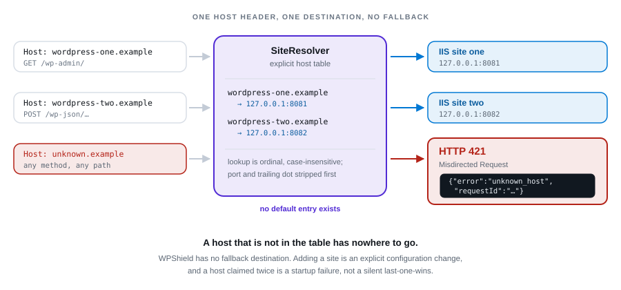
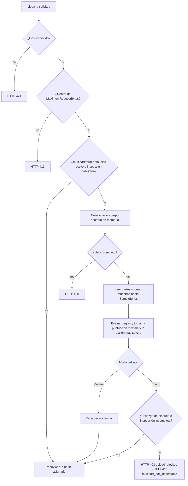

# Referencia del gateway

[English](../en/gateway-reference.md) · [Índice de documentación](../README.md)

## Cómo se ve un hallazgo

WPShield busca que cada decisión sea explicable. Cada hallazgo lleva un ID de regla estable, una puntuación, una clave de mensaje y la evidencia mínima que lo respalda, para que el operador pueda examinarlo.

<picture>
  <source media="(prefers-color-scheme: dark)" srcset="https://raw.githubusercontent.com/peopleworks/WPShield/main/assets/hero-dark.svg">
  
</picture>

Ninguno de los dos hallazgos bloquea por sí solo. El diseño hace que 50 + 30 alcancen el umbral y que el resultado muestre el ID, la puntuación y la evidencia de cada regla.

<details open>
<summary><b>Un ejemplo completo</b> con <code>invoice.php.jpg</code> y <code>web.config</code></summary>

Ambos llegan al endpoint de carga de WordPress de un sitio en modo `Monitor`, con los umbrales predeterminados de 30 para observar y 80 para bloquear.

```http
POST /wp-admin/async-upload.php HTTP/1.1
Host: wordpress-one.example
Content-Type: multipart/form-data; boundary=----WPShieldExample

------WPShieldExample
Content-Disposition: form-data; name="async-upload"; filename="invoice.php.jpg"
Content-Type: image/jpeg
```

**Primero se normaliza el nombre.** Las reglas reciben el valor normalizado.

| Enviado | Nombre en disco | Segmentos de extensión | Anomalías eliminadas |
| --- | --- | --- | --- |
| `invoice.php.jpg` | `invoice.php.jpg` | `php`, `jpg` | ninguna |
| `web.config` | `web.config` | `config` | ninguna |

**Luego se evalúan las reglas y se suman sus puntuaciones**, con un máximo de 100.

```json
{
  "SiteId": "wordpress-one",
  "Score": 80,
  "RecommendedAction": "Observe",
  "Findings": [
    {
      "RuleId": "WP-UPLOAD-001",
      "Score": 50,
      "MessageKey": "Findings.ExecutableUploadExtension",
      "Evidence": {
        "extension": ".php",
        "position": "embedded",
        "normalizedName": "invoice.php.jpg"
      }
    },
    {
      "RuleId": "WP-UPLOAD-002",
      "Score": 30,
      "MessageKey": "Findings.DisguisedUploadExtension",
      "Evidence": {
        "executableExtension": ".php",
        "presentedExtension": ".jpg",
        "normalizedName": "invoice.php.jpg"
      }
    }
  ]
}
```

`web.config` requiere una sola regla.

```json
{
  "SiteId": "wordpress-one",
  "Score": 100,
  "RecommendedAction": "Observe",
  "Findings": [
    {
      "RuleId": "IIS-CONFIG-001",
      "Score": 100,
      "MessageKey": "Findings.IisConfigurationUpload",
      "Evidence": { "normalizedName": "web.config" }
    }
  ]
}
```

1. **`RecommendedAction` es `Observe` por el modo del sitio.** En `Block` las mismas solicitudes devuelven `Block` con 80 y 100 puntos, respectivamente. Monitor es el valor predeterminado y el operador decide si activa el bloqueo por sitio.
2. **`.php` en una posición intermedia puntúa 50.** Algunos entornos PHP-FastCGI con `cgi.fix_pathinfo` o asignaciones de handler con comodines en IIS ejecutan estos nombres. La señal llega al umbral al combinarse con el hallazgo de disfraz.
3. **`web.config` es específico de Windows.** IIS lo lee en todos los directorios que sirve. En `wp-content/uploads` puede registrar un handler, reactivar la ejecución de scripts o relajar la autorización del directorio, lo que permitiría ejecutar código sin cargar un script.
4. **Un `readme.php.txt` benigno también puntúa 80.** El nombre por sí solo es insuficiente para distinguirlo de `invoice.php.jpg`. Revisa las cargas reales de cada sitio en `Monitor` antes de usar `Block`. `archive.tar.gz`, `style.min.css` y `holiday.jpg` puntúan cero.

La demostración usa `..\..\photo.php.jpg.` y un marcador PHP inocuo.

```powershell
dotnet run --project src/WPShield.Service
```

```json
{
  "SiteId": "wordpress-one",
  "Score": 100,
  "RecommendedAction": "Observe",
  "Findings": [
    { "RuleId": "WP-UPLOAD-001", "Score": 50, "MessageKey": "Findings.ExecutableUploadExtension",
      "Evidence": { "extension": ".php", "position": "embedded", "normalizedName": "photo.php.jpg" } },
    { "RuleId": "WP-UPLOAD-002", "Score": 30, "MessageKey": "Findings.DisguisedUploadExtension",
      "Evidence": { "executableExtension": ".php", "presentedExtension": ".jpg", "normalizedName": "photo.php.jpg" } },
    { "RuleId": "FILE-NAME-001", "Score": 60, "MessageKey": "Findings.UnsafeUploadFileName",
      "Evidence": { "anomalies": "pathSeparator,trailingDotsOrSpaces", "normalizedName": "photo.php.jpg" } },
    { "RuleId": "PHP-CONTENT-001", "Score": 75, "MessageKey": "Findings.PhpTagInUpload", "Evidence": null }
  ]
}
```

`FILE-NAME-001` registra el prefijo de directorio y el punto final como anomalías y esos caracteres se descartan. La evidencia conserva el nombre normalizado para evitar que caracteres de control lleguen intactos a un consumidor de logs.

</details>

> [!NOTE]
> El JSON lo produce el motor de inspección. En el gateway, cada cuerpo `multipart/form-data` se almacena temporalmente en memoria dentro del límite de solicitud. Cada archivo se reduce a un nombre y a una muestra inicial acotados. El gateway evalúa las reglas y reenvía o rechaza según el modo del sitio. Los formularios urlencoded, JSON, XML-RPC y PUT con `application/octet-stream` se transmiten directamente. Consulta la [inspección multipart acotada](m2-inspeccion-multipart.md) y el [estado del proyecto](referencia-operador.md#estado-del-proyecto).

## Por qué WPShield

Los sitios WordPress en Windows Server necesitan una capa que entienda las cargas de WordPress y el alojamiento en IIS. WPShield inspecciona antes de IIS, PHP o WordPress y busca preservar el aislamiento entre sitios, el control del operador y la evidencia.

<picture>
  <source media="(prefers-color-scheme: dark)" srcset="https://raw.githubusercontent.com/peopleworks/WPShield/main/docs/assets/iis-gap-dark.svg">
  
</picture>

WPShield busca cubrir varios sitios Windows con un destino IIS explícito por hostname, detectar cargas ejecutables, PHP disfrazado y discrepancias de tipo, inspeccionar datos acotados sin almacenar cargas sospechosas, comenzar en `Monitor` y permitir al operador activar `Block` por sitio. Los hallazgos tienen IDs estables. Las reglas, los mensajes y la documentación son extensibles y multilingües. WPShield complementa Microsoft Defender y el endurecimiento habitual de WordPress. El alcance excluye antivirus, EDR, escaneo de archivos en disco, parches de WordPress y mitigación volumétrica de DDoS.

## Arquitectura

WPShield separa los contratos y las reglas reutilizables del alojamiento HTTP.



### Cómo encuentra su sitio una solicitud

El gateway actual se evalúa localmente. El tráfico público sigue usando los bindings de IIS en los puertos 80 y 443.

<picture>
  <source media="(prefers-color-scheme: dark)" srcset="https://raw.githubusercontent.com/peopleworks/WPShield/main/docs/assets/host-resolution-dark.svg">
  
</picture>

La comparación ignora mayúsculas y minúsculas y elimina el puerto y el punto final. No hay comodines. Un hostname duplicado impide el arranque.

### Cómo se inspecciona una solicitud

Estos pasos ya se ejecutan. Una solicitud que no sea `multipart/form-data`, que pertenezca a un sitio en `Disabled` o que llegue cuando `Gateway:Multipart:Enabled` es `false` continúa sin asignar un búfer.



## Modelo de seguridad

- **Monitor de forma predeterminada.** El bloqueo requiere configuración explícita por sitio.
- **Rechazo de hosts desconocidos.** El gateway carece de destino alternativo.
- **Loopback durante M1 y M2.** Los listeners del gateway y de administración son locales.
- **Cabeceras de reenvío no confiables reemplazadas.** Las cabeceras `X-Forwarded-*` que vienen de Internet carecen de autoridad.
- **Procesamiento acotado.** Cuerpos, flujos, muestras, secciones, cabeceras y tiempos de espera tienen límites.
- **Cargas sospechosas sin persistencia.** La inspección evita escribirlas en disco.
- **Evidencia que preserva la privacidad.** Se excluyen credenciales, autorizaciones, cookies, nonces, tokens, consultas completas, cuerpos y contenido de las cargas.
- **Decisiones explicables.** Cada hallazgo incluye un ID estable, puntuación, clave de mensaje, evidencia mínima y acción recomendada.
- **Cambios de producción controlados.** La evaluación del gateway permanece en loopback y deja las vinculaciones públicas de IIS intactas. Consulta las [instrucciones del repositorio](../../AGENTS.md) para el alcance de cada comando.
- **Bloqueo de host no disponible.** La CLI rechaza el filtro anterior antes de acceder a un controlador de paquetes.
- **Monitor de seguridad de solo lectura.** El registro de seguridad de Windows requiere permisos de administrador. El monitor lo lee y lo deja intacto.
- **Hallazgos de observación.** La CLI los envía a su salida.

Consulta el [modelo de amenazas](modelo-de-amenazas.md) y la [política de reporte de vulnerabilidades](../../SECURITY.md).

## Reglas actuales

Las reglas usan la normalización de Windows para reconocer que `shell.php.`, `shell.php `, `shell.php::$DATA` y `..\..\shell.php` se escriben como `shell.php`.

| ID de regla | Señal | Puntuación |
| --- | --- | --- |
| `IIS-CONFIG-001` | Carga llamada `web.config`, que puede habilitar ejecución de código en IIS | 100 |
| `WP-UPLOAD-001` | Extensión ejecutable por PHP en cualquier posición | 90 final, 50 intermedia |
| `IIS-UPLOAD-001` | Extensión ejecutable por IIS (`.aspx`, `.ashx`, `.asmx`, …) en cualquier posición | 90 final, 50 intermedia |
| `PHP-CONTENT-002` | Firma válida de imagen con PHP después de los datos propios de la imagen, como el políglota `GIF89a;` que pasa `getimagesize()` | 85 |
| `PHP-CONTENT-001` | `<?php` o `<?=` en una muestra acotada | 75 |
| `FILE-TYPE-001` | Discordancia entre la extensión final y el formato de los primeros bytes | 70 script, 70 `MZ`/ELF, 40 texto plano |
| `FILE-NAME-001` | Separador, flujo alternativo, puntos o espacios finales, carácter de control, nombre reservado o longitud excesiva | 60 |
| `WP-UPLOAD-002` | Extensión ejecutable seguida de otra benigna, como `photo.php.jpg` | 30 |

Se suman las puntuaciones de cada archivo hasta 100. Los umbrales predeterminados son 30 para observar y 80 para bloquear. Entre varios archivos, el gateway toma la mayor puntuación individual. `IIS-CONFIG-001` e `IIS-UPLOAD-001` cubren la superficie de Windows.

Las reglas se ejecutan en solicitudes `multipart/form-data`. `FILE-TYPE-001` omite `Content-Type` porque el navegador lo deriva de la extensión y otros clientes pueden usar `application/octet-stream` legítimamente. Consulta los falsos positivos en las [reglas de carga](m2-reglas-carga.md), los límites en la [guía multipart](m2-inspeccion-multipart.md) y las reglas de [ruta de solicitud](m2-5-inspeccion-ruta-solicitud.md). Cada regla nueva requiere pruebas benignas, análisis de falsos positivos, evidencia segura y documentación en los dos idiomas.

## Trazabilidad y completitud de la inspección

El endpoint de reenvío emite un evento final `request_completed` con `SchemaVersion=1`. `RequestId` vincula los hallazgos y la cabecera `X-WPShield-Request-ID` al resultado. La evidencia registra las versiones, un identificador opaco de activación de configuración, el sitio y cliente resueltos y el resultado por etapa.

| Pregunta | Evidencia |
| --- | --- |
| ¿Qué se ejecutó? | Versiones del gateway, el motor y las reglas, más `ConfigurationRevision`, que cambia al reiniciar |
| ¿Qué se inspeccionó? | Estados separados de ruta y carga (`not_started`, `not_inspected`, `partial` o `complete`) con motivos, puntuaciones e IDs de regla |
| ¿Qué recomendaron las reglas? | `PathAction` y `UploadAction` con el modo y los umbrales del sitio; Monitor puede registrar `Observe` y permitir el reenvío |
| ¿Qué pasó? | `Disposition` informa `forwarded`, `rejected`, `forwarding_failed`, `cancelled` o `failed` con el motivo y si se intentó reenviar |

Una carga sospechosa en Monitor puede registrar `UploadAction=Observe` y terminar con `Disposition=forwarding_failed` si el backend no responde. Las pruebas de evidencia cubren modos, cuerpos mal formados, capacidad, tamaño, tiempos de espera, cancelación, fallos del backend, privacidad y consistencia de las direcciones.

Una inspección completa abarca las muestras iniciales configuradas y las variantes de nombre. El identificador de activación no conserva la configuración. Si faltan eventos, el resultado es desconocido. El filtrado, la saturación, los fallos de almacenamiento y las caídas pueden dejar huecos. El medidor local `WPShield.Evidence` informa las pérdidas observadas de cola y almacenamiento al margen del archivo de log. El estado degradado dura hasta el reinicio.

Consulta los [campos y las notas de compatibilidad](evidencia-solicitudes.md).

### Previsualizar una política antes de cambiarla

`wpshield preview` lee una copia local de un JSON Lines del gateway con eventos `request_completed`. Indica el `SiteId` exacto con `--site`. Este ejemplo estima el efecto de cambiar a Block con umbrales de 30 y 80.

```powershell
wpshield preview --log-file .\synthetic-evidence.jsonl --site wordpress-one.example --mode Block --observe-threshold 30 --block-threshold 80
```

Si una carga elegible puntuó 90 en Monitor, el informe indica `eligibleRecords: 1` y `newlyRefused: 1`. El comando escribe a stdout y deja intacta la política activa.

Lee `eligibleRecords` y `exclusions` junto a la estimación. Cuando no hay registros comparables los campos de impacto son `null`. Los presupuestos predeterminados son 10 000 líneas, 16 MiB y 10 segundos. `stopReason` indica el límite que interrumpió la lectura. Consulta la [guía de elegibilidad, privacidad y códigos de salida](vista-previa-politicas.md).

## Configuración

El gateway lee `Gateway` y `Sites` de `src/WPShield.Gateway/appsettings.json`. El archivo distribuido usa hostnames de ejemplo. Los valores del operador van en `appsettings.Local.json`, ignorado por Git y excluido de la publicación, o en variables de entorno `WPSHIELD_`.

```json
{
  "Gateway": {
    "Urls": ["http://127.0.0.1:10000"],
    "AllowRemoteHealthChecks": false,
    "ActivityTimeoutSeconds": 100,
    "MaximumRequestBytes": 6291456,
    "Multipart": {
      "Enabled": true,
      "MaximumFileCount": 20,
      "MaximumFieldCount": 200,
      "MaximumPartHeaderBytes": 16384,
      "SampleBytes": 4096,
      "ReadTimeoutSeconds": 30
    }
  },
  "Sites": [
    {
      "Id": "wordpress-one",
      "Hosts": ["wordpress-one.example", "www.wordpress-one.example"],
      "Destination": "http://127.0.0.1:8081",
      "Mode": "Monitor",
      "ObserveThreshold": 30,
      "BlockThreshold": 80
    }
  ]
}
```

> [!IMPORTANT]
> La configuración se valida al arrancar y queda fija durante la ejecución. Compara `ConfigurationRevision` del arranque con el evento final para identificar la política activa. La tabla del arranque enumera los hosts activos. Consulta la [superposición local y la combinación de arreglos](configuracion-operador.md).

| Ajuste | Función |
| --- | --- |
| `Gateway:Urls` | URLs de escucha, con IPs de loopback en M1/M2 |
| `Gateway:AllowRemoteHealthChecks` | Mantiene locales los endpoints de salud con `false` |
| `Gateway:ActivityTimeoutSeconds` | Tiempo de espera de actividad del reenvío |
| `Gateway:MaximumRequestBytes` | Límite del cuerpo y del búfer multipart, 6 MiB por defecto y máximo de 64 MiB |
| `Gateway:Multipart:Enabled` | Habilita la inspección multipart. Con `false` transmite directo y advierte al arrancar |
| `Gateway:Multipart:MaximumFileCount` | Partes de archivo por solicitud, 20 por defecto y máximo de 100 |
| `Gateway:Multipart:MaximumFieldCount` | Partes sin archivo por solicitud, 200 por defecto y máximo de 1000 |
| `Gateway:Multipart:MaximumPartHeaderBytes` | Cabeceras por parte, 16 KiB por defecto y máximo de 32 KiB |
| `Gateway:Multipart:SampleBytes` | Bytes iniciales por archivo, 4096 por defecto, entre 512 y 64 KiB. Las reglas `FILE-TYPE-001` y `PHP-CONTENT-002` requieren ese mínimo |
| `Gateway:Multipart:MaximumConcurrentInspections` | Búferes retenidos entre todos los sitios, incluido el reenvío. Por defecto 10, máximo 50. Al llegar al límite, Monitor reenvía y Block devuelve 429 |
| `Gateway:Multipart:ReadTimeoutSeconds` | Plazo de lectura, 30 segundos por defecto y máximo de 120 |
| `Sites[].Id` | Identificador estable para enrutamiento y hallazgos |
| `Sites[].Hosts` | Hostnames explícitos del sitio |
| `Sites[].Destination` | IIS en loopback o backend sintético del sitio |
| `Sites[].Mode` | `Monitor`, `Block` o `Disabled`. Usa `Monitor` al evaluar |
| `ObserveThreshold` / `BlockThreshold` | Umbrales de puntuación para decidir la acción |

M1.1 valida que existan sitios, los hosts sean únicos y las escuchas y destinos sean seguros. Los destinos de laboratorio deben estar en loopback y se rechaza un destino que apunte al gateway. Un valor multipart fuera de rango impide el arranque. Los límites efectivos y la tabla de sitios se imprimen al iniciar.

## Qué significa cada respuesta

Las demás respuestas llegan del backend y se reenvían intactas. `403`, `408` y `415` se incorporaron con la inspección multipart acotada.

| Estado | Cuándo | Cuerpo |
| --- | --- | --- |
| `421 Misdirected Request` | El `Host` carece de sitio configurado y de backend predeterminado | `{"error":"unknown_host","requestId":"…"}` |
| `403 Forbidden` | Una carga llega al umbral en `Block` | `{"error":"upload_blocked","requestId":"…","ruleIds":["…"]}` |
| `415 Unsupported Media Type` | En `Block`, el multipart incumple el formato o un límite de frontera, archivos, campos, cabeceras o nombres. Monitor reenvía y avisa | `multipart_not_inspectable` con `requestId`, `reason` (`malformed` o `limit_exceeded`) y la regla `GATEWAY-MULTIPART-001` |
| `429 Too Many Requests` | En `Block`, se agotan los búferes o el presupuesto de tasa. Monitor registra y reenvía. Solo el caso de tasa agrega `Retry-After` | `multipart_concurrent_limit_exceeded` o `rate_limited` con `requestId` |
| `408 Request Timeout` | El cuerpo queda incompleto al vencer `Gateway:Multipart:ReadTimeoutSeconds`, incluido Monitor | `{"error":"request_timeout","requestId":"…"}` |
| `413 Content Too Large` | El `Content-Length` o el cuerpo transmitido excede `Gateway:MaximumRequestBytes` | `{"error":"request_too_large","requestId":"…"}` |
| `502 Bad Gateway` | El backend asignado no está disponible o excede el plazo de actividad | `{"error":"backend_unavailable","requestId":"…"}` |
| `404 Not Found` en `/_wpshield/health/*` | La llamada no es local con `AllowRemoteHealthChecks` en `false` o la ruta no existe | — |

Un rechazo informa el ID de solicitud y de las reglas sin divulgar nombre original o normalizado, campo, muestra, evidencia, sitio, destino, puntuación ni umbrales. Los IDs ya son públicos. Revelar la puntuación facilitaría ajustar solicitudes a partir de cada respuesta.

Las dos rutas de salud locales responden `200`. `/_wpshield/health/live` devuelve `{"status":"live","service":"WPShield.Gateway"}` y `/_wpshield/health/ready` devuelve `{"status":"ready","sites":2}`. Todas las respuestas incluyen `X-WPShield-Request-ID` generado por el gateway y `X-Content-Type-Options: nosniff`. Las generadas por WPShield incluyen `Cache-Control: no-store`. La cabecera de ID entrante se descarta.

## Resolución de problemas

El gateway rechaza al arrancar una configuración que no puede validar. Los mensajes corresponden a `GatewayConfigurationValidator`.

| Mensaje de arranque | Qué significa |
| --- | --- |
| `M1 laboratory gateway may listen only on a loopback HTTP or HTTPS IP.` | `Gateway:Urls` contiene un valor que no es una IP de loopback, incluidos los hostnames |
| `Site '<id>' destination must remain on loopback during M1.` | El destino queda fuera de loopback. M1 y M2 son de laboratorio |
| `Site '<id>' destination must not point back to a WPShield listener.` | El puerto de destino coincide con el de escucha y generaría un bucle |
| `Host '<host>' is assigned more than once.` | Dos sitios reclaman el mismo hostname |
| `Configuration mixes real hostnames with the documentation placeholders shipped in appsettings.json…` | La combinación de arreglos deja valores de ejemplo activos. Declara todos los sitios y hosts en la [superposición local](configuracion-operador.md) |
| `Gateway:MaximumRequestBytes must be between 1 and 67108864 bytes.` | El límite queda fuera del intervalo permitido |
| `At least one site must be configured.` | `Sites` está vacío |
| `Failed to bind to address http://127.0.0.1:10000: address already in use.` | Ya hay un gateway. Detén esa instancia antes de arrancar otra |

Si editas `appsettings.json` durante la ejecución, reinicia y comprueba la tabla de sitios. Si un host conocido devuelve `502`, arranca el backend sintético o sitio IIS que corresponde a ese destino.
